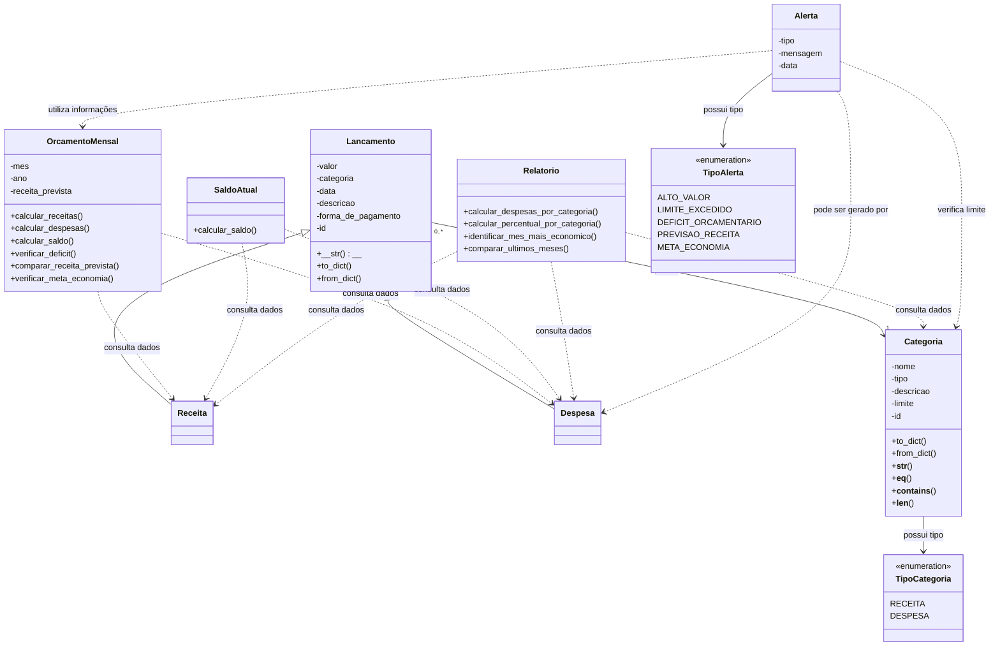

# UML — Sistema de Controle Financeiro

## Relações entre as classes

As setas do diagrama representam os relacionamentos e as dependências entre as classes do domínio:

- **Herança:** `Receita` e `Despesa` herdam os atributos e comportamentos de `Lancamento`.
- **Associação:** cada `Lancamento` possui uma `Categoria`, que determina sua classificação como receita ou despesa.
- **Dependência:** `OrcamentoMensal`, `SaldoAtual` e `Relatorio` utilizam informações de receitas, despesas e categorias para realizar seus cálculos e consultas.

### Relação com os repositórios

Embora os repositórios não estejam representados diretamente no diagrama, eles são responsáveis pela persistência e recuperação dos dados utilizados pelas classes:

- `Receita_Repositorio`: armazenamento, listagem e exclusão de receitas.
- `Despesa_Repositorio`: armazenamento, listagem e exclusão de despesas.
- `Categoria_Repositorio`: armazenamento, consulta, edição e exclusão de categorias.
- `Orcamento_Repositorio`: armazenamento e recuperação de orçamentos mensais.
- `Alerta_Repositorio`: armazenamento e recuperação dos alertas gerados pelo sistema.

As setas tracejadas representam dependências e consultas realizadas por meio desses repositórios, e não necessariamente associações diretas entre objetos. Dessa forma, o diagrama mantém o foco nas classes do domínio, enquanto os repositórios são descritos separadamente.
